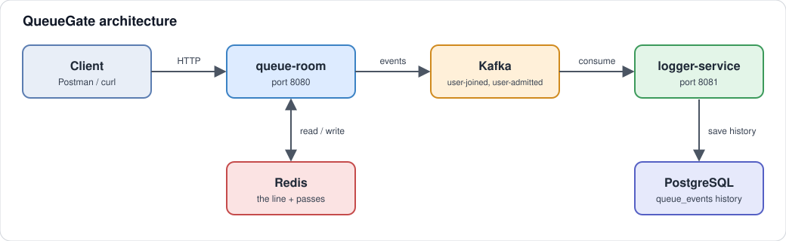

# QueueGate

> **Status: 🚧 In progress.** The core flow works end to end (join, wait, safe admit, event history in PostgreSQL). Step 8 (idempotent consumer, retries, dead-letter topic) is being built right now. See the [Roadmap](#roadmap) for what is done and what is not.

QueueGate is a **virtual waiting room**, like the line you see when a ticket-sale website is overloaded. Users join a line, can check their position, and are let in a few at a time using a short-lived pass.

I built it to practise event-driven backend design with **Redis**, **Kafka** and **PostgreSQL**, and to think carefully about what happens when things fail. There is no frontend. I test it with Postman and curl.

---

## How it works

1. A user **joins** the line. The first time they get `201`. If they join again while still waiting, they get `200` and nothing new happens.
2. Every **10 seconds** the scheduler admits up to **5 users** from the front of the line and gives each one a **pass valid for 5 minutes**.
3. The user presents the pass to `/api/enter` within 5 minutes to go through.
4. If the pass expires, the user is not put back in the line. They have to join again, which counts as a new join.

Every join and every admission is also published to **Kafka** as an event. A second application, **logger-service**, reads those events and stores them in **PostgreSQL** as a permanent history.

## Architecture


| Part | Job |
|---|---|
| **Redis** | The live line (a sorted set ordered by join time) and the passes (5-minute expiry). |
| **Kafka** | Carries events from queue-room to logger-service, so the two apps stay independent. |
| **PostgreSQL** | Permanent history of events. Used **only** by logger-service. |

Because the apps are independent, queue-room keeps working if logger-service is stopped. Kafka holds the events until logger-service reads them again, within Kafka's retention settings.

## Tech stack

- Java 21, Spring Boot 4.x, Maven
- Redis 7.2 (Spring Data Redis)
- Kafka (apache/kafka 3.7.0, single node, KRaft mode) with Spring for Apache Kafka
- PostgreSQL 16 with Spring Data JPA (logger-service only)
- Docker Compose
- JUnit 5, Mockito, Testcontainers

## Reliability decisions

These are the design choices I made on purpose:

- **A repeat join creates no second event.** The line uses "add only if absent", so a user who is already waiting is not added or published again.
- **Deterministic event IDs.** A join event ID is built from the user and the join time (for example `JOINED:ravi:1794551076235`), so the same join always has the same ID.
- **Same event twice gives one row.** The event ID is the primary key of the `queue_events` table, so a duplicate delivery cannot create a second row. A test proves this.
- **Safe admit order.** When admitting users, queue-room does not remove anyone from the line first. It reads the next users, creates their passes, publishes `user-admitted` and waits for Kafka to acknowledge it, and only then removes the users from the line. If the app crashes before the last step, the users are still in the line and the next run tries again. The worst case is a retry, not a lost user.
- **Failed publish leaves the user in the line.** If the admitted event cannot be published, the pass created in that run is deleted and the user stays in the line.

## Data

**Redis**
- A sorted set (`waiting_room_zset`) holds the waiting users, scored by join time.
- Each pass is stored with a 5-minute expiry.

**PostgreSQL, table `queue_events`**

| Column | Meaning |
|---|---|
| `event_id` | Primary key. Same event twice gives one row. |
| `user_id` | The user the event is about. |
| `type` | Event type, for example `JOINED`. |
| `occurred_at` | When it happened (server time). |

**Event message (JSON, sent through Kafka):** `eventId`, `type`, `userId`, `occurredAt`.

## Project layout

```
QueueGate/
├── docker-compose.yml     # Redis, Kafka, PostgreSQL
├── queue-room/            # the waiting room app (port 8080)
└── logger-service/        # reads Kafka events, saves to PostgreSQL (port 8081)
```

Planned additions: `.github/workflows/ci.yml`, `load-test/`, `docs/`.

## Getting started

**You need:** JDK 21, Docker Desktop, Git. The commands below are for Windows PowerShell. On Mac or Linux use `./mvnw` instead of `.\mvnw`.

```powershell
git clone https://github.com/ManojMT19/Queue-Gate.git
cd Queue-Gate

# 1. Start Redis, Kafka and PostgreSQL
docker compose up -d

# 2. Start queue-room (port 8080)
cd queue-room
.\mvnw spring-boot:run
```

Open a second terminal:

```powershell
# 3. Start logger-service (port 8081)
cd logger-service
.\mvnw spring-boot:run
```

**Try it:** join a user with Postman or curl, then look at the saved history:

```powershell
docker exec queuegate-postgres psql -U postgres -d waiting_room_db -c "SELECT * FROM queue_events;"
```

**Run the tests** (Docker must be running, because some tests use Testcontainers):

```powershell
cd logger-service
.\mvnw test
```

**Troubleshooting (Windows):** if logger-service fails to connect to PostgreSQL with `invalid value for parameter "TimeZone": "Asia/Calcutta"`, set this in the same terminal before starting it:

```powershell
$env:JAVA_TOOL_OPTIONS="-Duser.timezone=Asia/Kolkata"
```

> The database password in `application.properties` is for a local throwaway container only. It will move to environment variables before this project is considered finished.

## Roadmap

| Step | What | Status |
|---|---|---|
| 1 to 5 | Redis waiting line (join, position, size), controllers with validation, pass system with 5-minute expiry and `/api/enter`, FIFO admitter with a 10-second scheduler, Kafka producer for `user-joined` | ✅ Done |
| 6 | logger-service: reads `user-joined` from Kafka and saves events to PostgreSQL, with 3 automated tests | ✅ Done |
| 7 | Safe admit flow: read first, create pass, publish and wait for Kafka's acknowledgement, then remove from the line | ✅ Done |
| **8** | **Idempotent consumer, retries and a dead-letter topic** | **🚧 In progress** |
| 13 | GitHub Actions CI | ⏳ Planned |
| 12 | More tests, coverage report, Docker Compose cleanup | ⏳ Planned |
| 14 | Load test with k6 | ⏳ Planned |
| 15 | README finish and documentation | ⏳ Planned |

**What Step 8 will add** (none of this is built or tested yet, so it is not claimed):

- [ ] Handle duplicate deliveries on purpose ("already saved, skip") so they never cause a retry loop
- [ ] Retry temporary failures a few times with a short wait
- [ ] Send messages that can never succeed (for example invalid JSON) to a dead-letter topic, so they do not block the consumer
- [ ] Automated tests for each of the above
- [ ] Decide whether logger-service also stores `user-admitted` events

**After my exams:** statistics endpoint with a Redis cache, an admin API key check, and optional resilience features.

**Load test numbers:** none yet. They will be added here only after they are measured.

## Known limitations

I would rather list these than hide them:

- **Single instance only.** There is no lock on the admit step yet, so running two copies of queue-room could admit the same user twice.
- **A join event can be lost if Kafka is down.** The user is added to Redis first, and publishing to Kafka happens after. If publishing fails, the error is only logged. This is a known dual-write problem and is documented, not solved.
- **Crash gap.** If queue-room crashes at the wrong moment while admitting, a pass can exist for up to 5 minutes without a matching `user-admitted` event in the history.
- **Redis has no persistence set up.** If Redis restarts, the line is lost.
- **Single-node Kafka** is for development only.
- **Polling, not push.** Users have to ask for their position. There is no WebSocket or server-sent events yet.
- **Ghost users.** A user who gets a pass and never uses it still holds an admission slot until the pass expires.
- **No "user entered" event.** The system cannot count who actually used their pass.
- **Not exactly-once.** The design aims for "at least once delivery plus safe duplicates", not exactly-once processing.

## Author

Built by **Manoj M T** as a learning project in event-driven backend engineering.